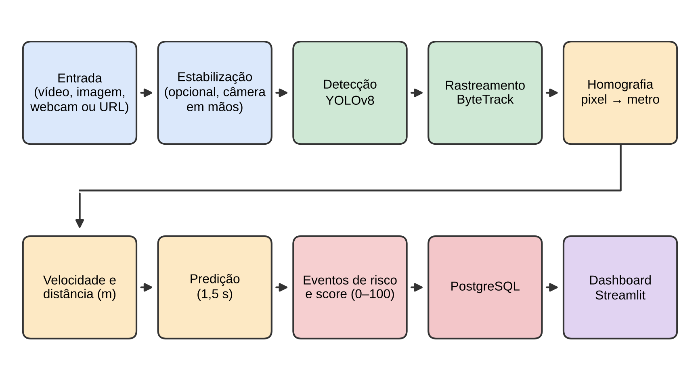
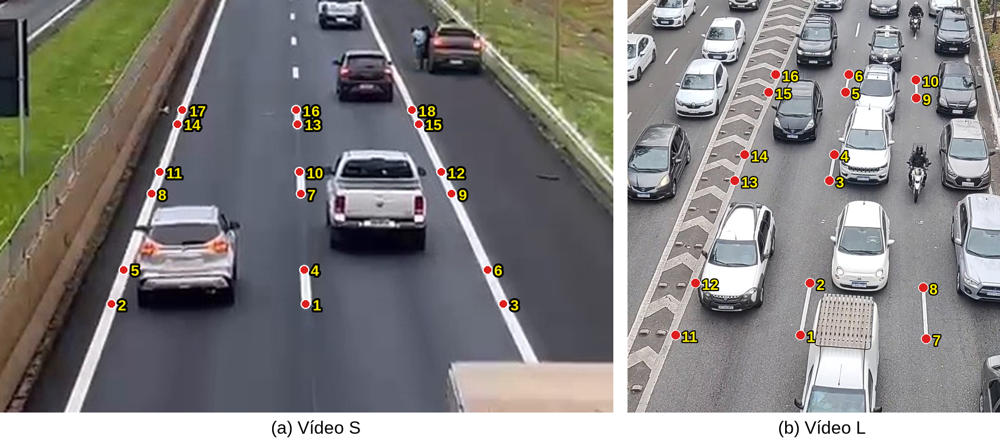
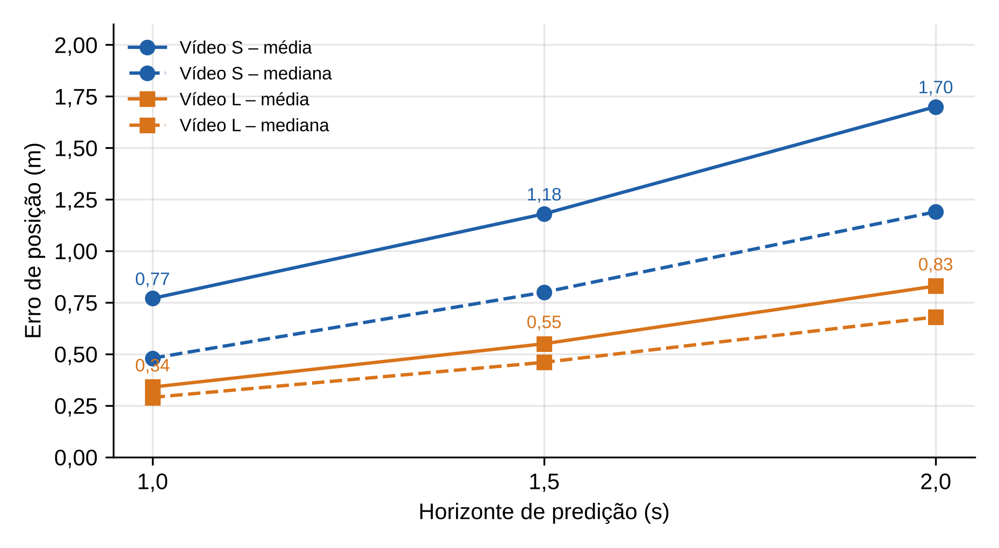
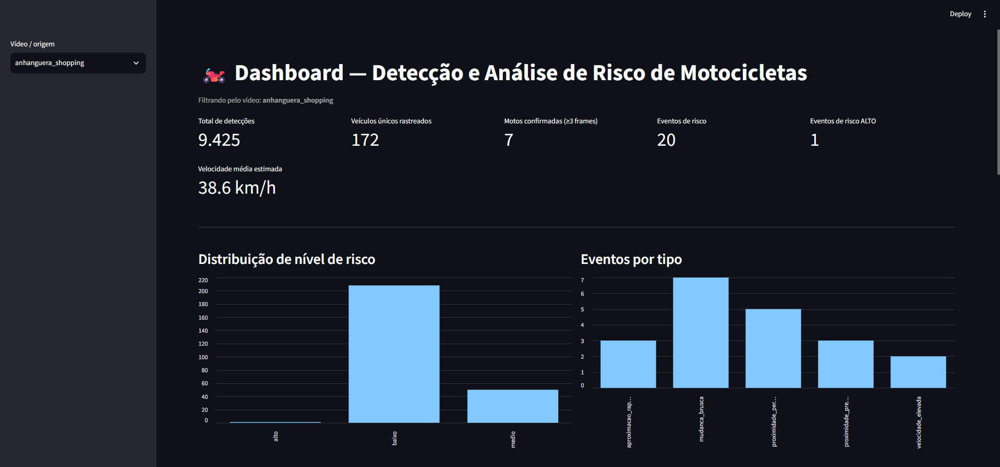

# Sistema inteligente para análise e predição de situações de risco envolvendo motociclistas

Trabalho de Conclusão de Curso — Ciência da Computação, UNIP (Ribeirão Preto), 2026.

Sistema de visão computacional que **detecta, rastreia e analisa motocicletas em vídeos de trânsito**, converte pixels em metros (homografia do plano da via), estima velocidade e distância entre veículos, **extrapola a posição por 1,5 s**, registra eventos e um **score de risco de 0 a 100** em PostgreSQL e exibe tudo em um **dashboard Streamlit**.

> **Leia isto antes:** o componente de aprendizado de máquina é o detector YOLOv8; o score é **baseado em regras**, e "predição" significa extrapolar a posição por movimento uniforme (1,5 s), **não prever acidentes**. A avaliação foi feita em **4 vídeos, poucas motocicletas e um único avaliador**; o sistema **não está validado para uso operacional**.

**Autores:** Samuel Fiuza da Silva, Guilherme Gouveia Fernandes e Alvaro Vicente de Oliveira Leite.
**Orientadora:** Profa. Dra. Eliana Leão do Prado Battaglion.

---

## Como funciona



Entrada (arquivo, imagem, webcam ou URL) → estabilização por software (vídeos gravados em mãos) → YOLOv8m → ByteTrack → homografia pixel→metro → velocidade e distância → eventos, predição e score → PostgreSQL → dashboard.

| Evento | O que registra | Peso no score |
|---|---|---|
| `proximidade_perigosa` | distância ao veículo mais próximo ≤ 2,0 m | 40 |
| `proximidade_prevista` | distância atual ≥ 2,0 m, mas prevista < 2,0 m em 1,5 s | 30 |
| `aproximacao_rapida` | distância caindo a ≥ 3,0 m/s | 20 |
| `zona_risco` | entrada em zona poligonal definida em JSON | 15 |
| `mudanca_brusca` | mudança de direção ≥ 45° ou variação ≥ 6 m/s² (informativo, não registrado por padrão) | 10 |
| `velocidade_elevada` | velocidade ≥ 60 km/h (informativo, não registrado por padrão) | 0 |

Níveis: 0–29 baixo · 30–59 médio · 60–100 alto. Só motocicletas geram eventos; os demais veículos servem de vizinhos.

## Resultados (resumo)

Calibração por homografia em 4 vídeos (A, B, S, L): erro quadrático médio de **0,28 a 0,45 m**; nas medidas independentes disponíveis, erro de distância de **−1,8% a +1,9%**.



**Predição a 1,5 s** (veículos em movimento ≥ 2 m/s): erro médio de posição de **1,18 m (vídeo S)** e **0,55 m (vídeo L)**, contra 15,98 m e 3,75 m ao supor o veículo parado.



**Avaliação com gabarito** (83 eventos marcados manualmente; precisão = eventos que correspondem a risco real):

| Evento | Risco real | Falso alarme | Precisão |
|---|---:|---:|---:|
| `proximidade_perigosa` | 15 | 0 | 100% |
| `proximidade_prevista` | 13 | 0 | 100% |
| `aproximacao_rapida` | 12 | 3 | 80% |
| `mudanca_brusca` | 12 | 20 | 38% |
| `velocidade_elevada` | 1 | 7 | 12% |
| **Todos** | **53** | **30** | **64%** |

Com base nisso, a predição passou a compor o score e `velocidade_elevada` e `mudanca_brusca` deixaram de ser registrados; na simulação sobre o próprio gabarito a precisão dos eventos registrados passou de 64% para 93% (22 das 27 motocicletas com risco real continuam cobertas). **O recall não foi medido.**



Detalhes, limitações e discussão completos estão na monografia.

## Início rápido

Requisitos: Python 3.10+, PostgreSQL e o modelo `yolov8m.pt`.

```bash
pip install -r requirements.txt

# credenciais do banco (a senha não tem valor padrão de propósito)
export DB_HOST=localhost DB_NAME=projeto_motos DB_USER=postgres DB_PASSWORD=sua_senha
# PowerShell: $env:DB_PASSWORD = "sua_senha"

# processar um vídeo já calibrado e abrir o dashboard
python main.py --source video.mp4 --calib-arquivo calibracoes/calib_S.json --origem meu_video
streamlit run dashboard.py

# testes
python -m pytest
```

As tabelas (`deteccoes`, `eventos`, `analise_risco`) são criadas na primeira execução.

## Documentação

| Documento | Conteúdo |
|---|---|
| [`docs/EXECUCAO.md`](docs/EXECUCAO.md) | Todos os comandos: instalação, estabilização, calibração, processamento, dashboard, testes, **câmeras ao vivo**, parâmetros e variáveis de ambiente |
| `CALIBRACAO_PONTOS.md`, `CALIBRACAO_REFERENCIAS.md` | Como os pontos de calibração foram marcados |
| `TESTES.md` | Guia dos testes automatizados e manuais |
| `calibracoes/` | Pontos (`pontos_*.csv`), calibrações (`calib_*.json`) e imagens de referência dos quatro vídeos |

## Estrutura

```
main.py                 ponto de entrada (vídeo/imagem/webcam/URL -> banco)
detector.py             YOLOv8 + ByteTrack (Ultralytics)
calibration.py          homografia pixel -> metro
calibrar_por_pontos.py  calibração a partir de CSV de pontos (RMS e validações)
ferramenta_calibracao.py ferramenta de clique para calibrar
estabilizar_video.py    estabilização por software de vídeos gravados em mãos
predicao.py             predição de posição (1,5 s)
state.py / risk.py      histórico por track, eventos e score
fonte.py                origem do vídeo e tempo de cada quadro
db.py                   persistência no PostgreSQL
dashboard.py            painel Streamlit (lê do banco)
dashboard_queries.py    consultas do painel
config.py               configurações, limiares e pesos (variáveis de ambiente)
tests/                  testes automatizados
```

## Vídeos e privacidade

Os vídeos **não** estão no repositório (tamanho e privacidade das imagens). Os vídeos A, B e S foram gravados pelos autores em passarela sobre a Rodovia Anhanguera, em Ribeirão Preto. O vídeo L é de Francis Camargo, obtido no [Pexels](https://www.pexels.com/pt-br/video/asfalto-onibus-negocio-empresa-18331566/) (licença gratuita, que permite modificação). O banco guarda posições, identificadores de rastreamento e tipo de veículo, não imagens nem placas. Uso com câmeras de terceiros exige autorização e observância da LGPD.

## Como citar

SILVA, S. F.; FERNANDES, G. G.; LEITE, A. V. O. **deteccaomotos**. GitHub, 2026. Disponível em: https://github.com/samufiuza/deteccaomotos.
